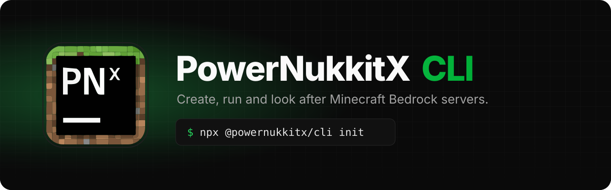

<p align="center">
  <picture>
    <source media="(prefers-color-scheme: dark)" srcset="assets/banner-dark.svg">
    <source media="(prefers-color-scheme: light)" srcset="assets/banner-light.svg">
    
  </picture>
</p>

<p align="center">
  <a href="https://www.npmjs.com/package/@powernukkitx/cli"></a>
  <a href="https://github.com/PowerNukkitX/pnx-cli/actions"></a>
  
  
  
  <a href="LICENSE"></a>
</p>

<p align="center">
  <a href="https://powernukkitx.org/docs/cli"><b>Documentation</b></a> ·
  <a href="#quick-start">Quick start</a> ·
  <a href="#commands">Commands</a> ·
  <a href="#powernukkitx-desktop-app">Desktop app</a> ·
  <a href="CONTRIBUTING.md">Contributing</a>
</p>

---

**`pnx`** turns a PowerNukkitX server into a one-command job. It downloads the
right jar, writes the start scripts, picks the Java flags, installs reviewed
plugins, takes backups and tells you the address your friends join, all
from a terminal that is pleasant to use and safe to script.

```text
┌   pnx  init  create a new server
│
◇  Where should the server live?
│  survival
│
◇  1/3  Downloading powernukkitx.jar  89.5 MB in 5.6s
◇  2/3  Start scripts written (start.bat, start.ps1)
◇  3/3  Set as the default server
│
◇  Next steps ───────────────────────────╮
│                                        │
│  cd survival                           │
│  pnx start   # Ctrl+C saves and stops  │
│                                        │
├────────────────────────────────────────╯
│
└  ✓ Created survival with PowerNukkitX 3.0.6 in 6.4s
```

## Quick start

You need [Node.js 20.12+](https://nodejs.org) and [Java 25](https://adoptium.net).

```bash
npx @powernukkitx/cli init survival     # create a server
cd survival
npx @powernukkitx/cli start             # run it
```

Or install it once and use `pnx` everywhere:

```bash
npm install -g @powernukkitx/cli
pnx                                     # the interactive dashboard
```

`pnx start` reads like `next dev`: the addresses to join, one spinner while the
world loads, then the moment players can connect.

```text
  ◆ PowerNukkitX 3.0.6
  - Local:    127.0.0.1:19132
  - Network:  192.168.1.15:19132
  - Java:     25 (Temurin) · up to 2G

✓ Ready in 3.1s  · 3 warnings (pnx logs)
  Type a server command here · Ctrl+C or `pnx stop` saves and stops
```

## Why pnx

|  |  |
| :-- | :-- |
| **Step by step** | Every command draws its story on one rail: questions, numbered steps with timings, a card with what to do next. |
| **A real dashboard** | `pnx` alone opens a menu that shows which server, whether it runs, its version and the address to join. |
| **Knows your server** | Tab completion for bash, zsh, fish and PowerShell completes commands, options, `pnx.yml` keys and backup names. |
| **Safe by default** | `stop` saves the world first, `backup restore` takes a safety copy first, `config set` keeps every comment. |
| **Made for scripts** | Non-zero exit codes on failure, `--json` on every read, `NO_COLOR` / `FORCE_COLOR`, no prompts without a terminal. |
| **Zero dependencies** | Nothing to audit at runtime; `npx` starts fast. |

## Commands

| | |
| :-- | :-- |
| `pnx init [dir]` | Create a server (`-y` takes every default) |
| `pnx start` / `stop` | Run it in the foreground; save and stop it from any terminal |
| `pnx status` | Is it up, since when, and the address players join |
| `pnx cmd <command>` | Type on the running server's console (no RCON needed) |
| `pnx logs` | Read and follow the log |
| `pnx config [get\|set]` | Show `pnx.yml`, or read / change one value by its key |
| `pnx plugin install\|search\|update\|remove` | The PowerNukkitX plugin marketplace |
| `pnx backup [list\|restore\|prune]` | Back up, browse, restore (with a safety copy), keep the newest *n* |
| `pnx update` | The newest PowerNukkitX, the old jar kept as `.old` |
| `pnx doctor` | Java, memory, disk and the configured port, checked |
| `pnx open [config\|logs\|plugins]` | Open the folder in your file manager or editor |
| `pnx completion` | Turn on Tab completion |

Every command has `--help`, and the [documentation](https://powernukkitx.org/docs/cli) covers each one.

## PowerNukkitX desktop app

The same engine, in a desktop window. **PowerNukkitX** (Electron,
Windows / Linux / macOS) drives the very functions `pnx` uses: a multi-server
registry, a live console with search and quick commands, a players panel, the
plugin marketplace, a visual `pnx.yml` editor, backups and restore, in-place
core updates and crash auto-restart, in five languages.

### Download

Get the installer for your system from the
[latest release](https://github.com/PowerNukkitX/pnx-cli/releases/latest):
`PowerNukkitX-Setup-x.y.z.exe` (Windows), `PowerNukkitX-x.y.z-x86_64.AppImage`
(Linux) or `PowerNukkitX-x.y.z-arm64.dmg` (macOS). Installed copies update
themselves.

The Windows builds are signed through the [SignPath Foundation](https://signpath.org)
(see the [code signing policy](#code-signing-policy)).

```bash
npm run app:start       # dev window
npm run app:dist        # Windows installer (app:dist:linux, app:dist:mac)
```

## Repository

```
packages/cli/   @powernukkitx/cli - the pnx and pnxcli commands (TypeScript)
packages/app/   PowerNukkitX - the desktop app (Electron)
assets/         README banners (rebuilt by packages/cli/scripts/make-banner.mjs)
```

```bash
npm install            # both workspaces
npm run build          # compile the CLI
npm run cli:dev        # pnx --help, from source
npm run typecheck
```

### Releasing

Bump `version` in `packages/app/package.json` and/or `packages/cli/package.json`
and push to `master`. The [Release workflow](.github/workflows/release.yml)
builds the app for Windows, Linux and macOS, publishes the CLI to npm, and
creates the GitHub releases (`app-vX.Y.Z`, `cli-vX.Y.Z`) with an English
changelog written from the commits
([Conventional Commits](https://www.conventionalcommits.org): `feat:`, `fix:`…,
bullet lines in the body become sub-items).

Runtime state lives in `~/.pnx-cli` (or `PNX_HOME`): the default server, the
release cache, the hub token and the desktop app's preferences.

## Code signing policy

Free code signing for the Windows builds is provided by
[SignPath.io](https://about.signpath.io), with a certificate by the
[SignPath Foundation](https://signpath.org).

- Every signed file is built from this repository's source by the
  [Release workflow](.github/workflows/release.yml) on GitHub Actions; nothing
  built on a personal machine is signed.
- Committers and reviewers: the [PowerNukkitX organization members](https://github.com/orgs/PowerNukkitX/people)
  with write access to this repository.
- Approvers: [AzaleeX](https://github.com/AzaleeX). Each signing request is
  approved by hand before the release is published.

## Privacy

This program will not transfer any information to other networked systems
unless specifically requested by the user or the person installing or
operating it.

What it does contact, and why:

- `powernukkitx.org`: the PowerNukkitX release list, the plugin hub (search,
  install, update) and, only if you link an account, your hub token.
- `github.com`, `api.github.com`, `raw.githubusercontent.com`: downloading
  PowerNukkitX and, for the desktop app, checking for and downloading its own
  updates (can be turned off in its settings).
- `api.adoptium.net`, `adoptium.net`: finding a Java runtime when you ask for one.
- `registry.npmjs.org`: the CLI's once-a-day check for a newer version
  (`PNX_NO_UPDATE_CHECK=1` turns it off).
- Servers on a VPS: the SSH host, user and key or password you enter, used only
  to reach that machine. Saved passwords are encrypted with the operating
  system's keychain.

No analytics, telemetry or crash reports are collected.

## License

[MIT](LICENSE) © AzaleeX and the PowerNukkitX contributors
