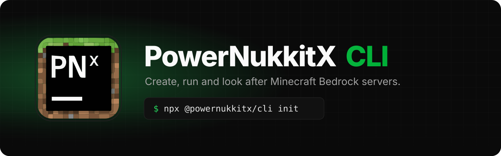

<p align="center">
  
</p>

# PowerNukkitX Toolkit

Two doors to the same engine:

- **`pnx`** — the CLI. Manage a PowerNukkitX server from the terminal: create,
  start/stop, plugins, backups, Java/port checks, hub pairing.
- **`pnxcli`** — the guided launcher. One job: create a server, start to finish,
  with prompts instead of flags.
- **`pnxcli.exe`** (desktop) — `packages/app/` builds a full desktop assistant
  (Windows/Linux/macOS) that wraps the same logic in a real GUI: a creation
  wizard with a live download bar, a server console with ANSI colours, and a
  seven-step guided tutorial. UI in five languages
  (Français / English / Español / Deutsch / Português-BR), switchable in the
  sidebar, persisted in `~/.pnx-cli/assistant.json`.

## Install

```sh
npm install -g @powernukkitx/cli
pnx --help
pnxcli            # guided server creation
```

## CLI quick tour

```sh
pnx init                 # create a server in this folder
pnx start                # run it; Ctrl+C saves the world and stops it
pnx start -m 4G -r       # 4 GB max, restart after a crash (3 times in 10 min)
pnx status               # running? since when? the LAN address players join
pnx cmd say Hello        # type on the running server's console (no RCON needed)
pnx stop                 # save and stop (pnx stop --force kills it)

pnx config get port              # one value, bare - ready for scripts
pnx config set motd "Survival"   # change one value, every comment kept
pnx open config                  # pnx.yml in your editor

pnx search worldedit     # = pnx plugin search
pnx install <slug>       # = pnx plugin install
pnx uninstall <name>     # = pnx plugin remove

pnx backup --keep 7      # copy worlds, plugins, config; keep the newest 7
pnx backup list          # every backup, with age and size
pnx backup restore       # put one back (a safety copy is taken first)
pnx update               # newest PowerNukkitX; the old jar is kept as .old
pnx doctor               # Java, memory, disk and the configured port
pnx completion           # Tab completion: bash, zsh, fish, PowerShell
pnx                      # menu, when you'd rather pick than type
```

Built to be pleasant by hand and safe in scripts:

- **Zero runtime dependencies** - fast `npx`, nothing to audit.
- **Tab completion** that knows your server: commands, options, `config` keys,
  backup names, installed plugins. It asks `pnx` itself, so it never drifts.
- **Did you mean** for commands, options, choices and config keys.
- Every command exits non-zero when it fails, so scripts can rely on `$?`;
  `--json` prints one JSON document and nothing else (`pnx --json doctor`
  exits 1 when the server cannot start - CI-friendly).
- Colour follows the conventions: `--no-color` / `NO_COLOR`, `--color` /
  `FORCE_COLOR`, plain text when piped. `--debug` adds the stack trace.
- A once-a-day "update available" line, never in scripts, CI, pipes or
  `--json` (`PNX_NO_UPDATE_CHECK=1` silences it).

Set `GITHUB_TOKEN` if GitHub rate-limits your address (60 requests an hour without it).

## Desktop assistant (`packages/app/`)

Electron app, driven by the compiled CLI: the main process imports
`services/*` from `dist/` (vendored at package time into `resources/cli`) so
the GUI and the CLI can never disagree about how a server is created or
launched.

```sh
npm install             # from the repo root (both workspaces)
npm run app:start       # dev window
npm run app:dist        # Windows: NSIS installer + portable .exe
npm run app:dist:linux  # AppImage
npm run app:dist:mac    # .dmg (on a mac)
```

Release artifacts land in `packages/app/release/`. The installer ships the official
PowerNukkitX site mark (`assets/icon.svg`, rendered by
`scripts/make-icons.mjs` into `packages/app/icons/icon.ico` / `.png`).

Everyday niceties: single-instance lock (a second launch focuses the running
window), Ctrl+1..6 to switch views, a live console with clear / copy / auto
scroll, a one-click `pnx.yml` opener, and progress bars that keep sweeping
when the jar size is unknown.

**Multi-server registry** — the assistant tracks several servers at once
(the CLI's default joins automatically on first run), shown as chips in the
« Mon serveur » view: click to switch, pencil to rename, trash to remove
(files stay on disk). The active server drives everything: start / stop,
the plugins install target, and the config editor. New servers join the
registry right after `pnx init` finishes.

**Settings view** — a real editor for `pnx.yml` (falls back to
`server.properties`): every leaf key becomes a labelled control — toggles
for booleans, numbers for counts/ports, a language pick-list for the server
locale — grouped by section, with the file's own comments as tooltips.
Saving rewrites only the touched lines (comments and layout survive) and
keeps a one-shot `.assistant-bak` copy; lists, objects and the `config:`
block stay read-only. pnx.yml appears there after the server's first boot.

A full **Plugins** view searches the PowerNukkitX hub (`powernukkitx.org`,
the same `/api/v1` endpoints `pnx plugin` drives), installs the reviewed
jar straight from GitHub releases with a sha256 check, and tracks instals
so reinstall / remove stay one click away. Overriding the hub still works
with `PNX_API_URL`.

Design system: the site's own tokens — `#0a0a0a` surfaces, `#111` cards, the
grass accent `oklch(0.76 0.21 148)` (`#25d35c`), gold `#d59800`, red `#d81327` —
with Manrope + Geist Mono fonts fetched from powernukkitx.org, arranged with a
LaunchUI spine: expanded sidebar (grouped entries, active pill with a glowing
bar), a topbar that names the current view, rounded cards, and one accent that
points. Every visible string lives in `packages/app/renderer/i18n.js`; the main process
emits creation logs as i18n keys so the whole UI, logs included, follows the
picked language.

## Layout

```
src/            CLI sources (TypeScript, compiled to dist/)
  bin/      pnx.ts dispatcher, pnxcli.ts launcher entry
  cli/      arg parser, registry, help
  commands/ init/start/stop/plugins/doctor/…
  services/ release, server, plugins, backup, config-file, process, agent/*
  infra/    http, store, paths
  ui/       theme (palette/glyphs), kit (output), prompt (hand-rolled prompts)
packages/app/ Electron assistant (src/main.cjs, src/preload.cjs, renderer/)
assets/     brand sources (official site icon)
scripts/    make-icons.mjs, clean.js
```

(The `src/`, `assets/` and `scripts/` paths above resolve inside
`packages/cli`.)

State lives in `~/.pnx-cli`: `config.json` (default server dir, hub token),
release caches, and the assistant's own `assistant.json`.

## Development

```sh
npm run typecheck   # tsc strict
npm run build
npm run smoke       # CLI end-to-end sanity
npm run smoke:launcher
```
